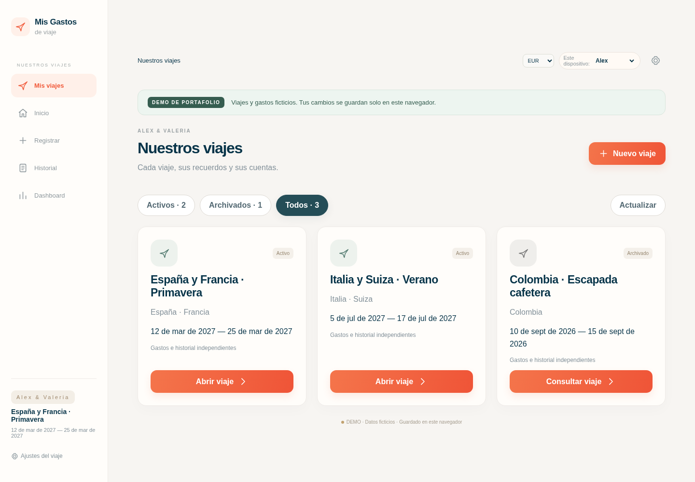
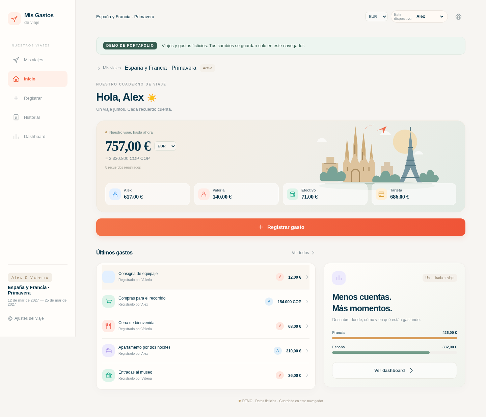
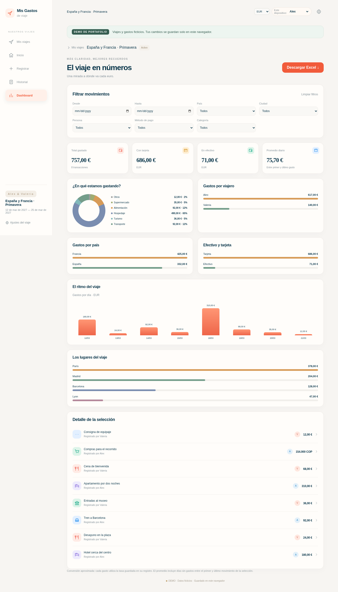
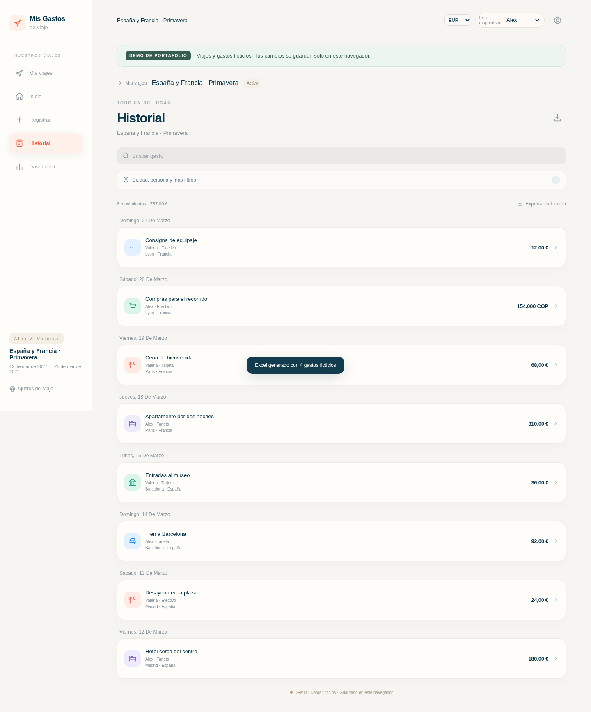
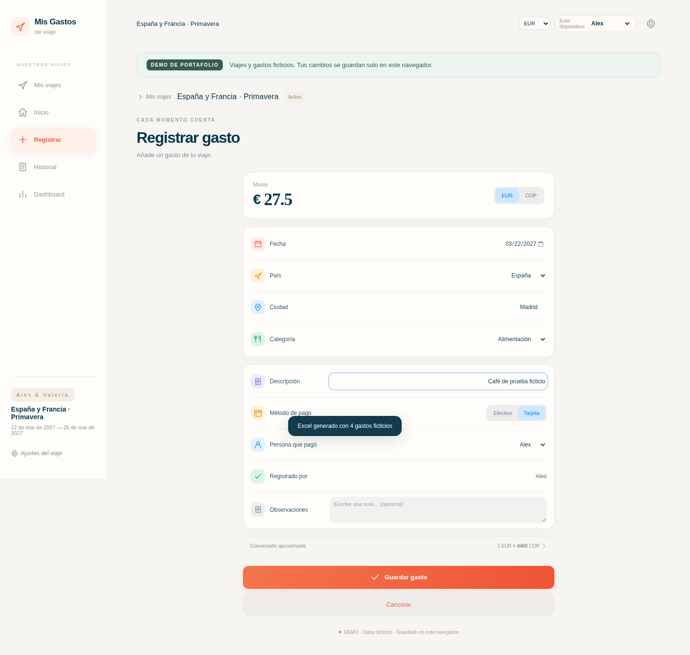
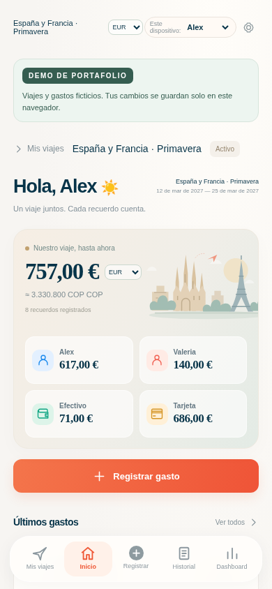

# Mis Gastos de Viaje | Portafolio

**Varios viajes, dos viajeros y todas las cuentas en un solo lugar.**

Proyecto de portafolio de **Juan Soto**, desarrollado con JavaScript, HTML y CSS. Permite organizar viajes, registrar gastos en euros o pesos colombianos y entender cómo se distribuye el presupuesto entre personas, destinos y métodos de pago.

> **Demostración con datos ficticios.** Alex y Valeria son personajes de ejemplo. Esta copia funciona con almacenamiento local del navegador y está separada de cualquier base de datos de producción. No incluye gastos reales, sesiones, claves ni respaldos privados.

[Funciones](#funciones-principales) · [Probar en tu computador](#cómo-probar-la-aplicación) · [Galería](#capturas-de-la-aplicación) · [Validación](VALIDACION.md) · [Seguridad](SECURITY.md)



## ¿Qué problema aborda?

Las reservas, transportes, comidas y compras de un viaje suelen quedar repartidos entre tarjetas, efectivo y registros personales. La aplicación reúne esos movimientos y distingue quién pagó de quién registró cada gasto, manteniendo las cuentas de cada viaje separadas.

El proyecto demuestra **gestión de información**, **cálculos financieros**, **persistencia local**, **visualización de datos**, **diseño adaptable** y **exportación de reportes**.

## Funciones principales

| Módulo | Qué permite hacer |
| --- | --- |
| Biblioteca de viajes | Abrir viajes activos o archivados y crear otros con gastos en cero. |
| Registro de gastos | Seleccionar viajero, país, ciudad, fecha, categoría, moneda y medio de pago. |
| Historial | Buscar, consultar detalles, editar y eliminar registros. |
| Dashboard | Combinar filtros por persona, destino, fechas, categoría y medio de pago. |
| Conversión de monedas | Consultar equivalentes EUR/COP usando la tasa guardada en cada gasto. |
| Excel | Descargar el viaje completo o la selección filtrada, con detalle y resumen numéricos. |
| Archivo | Conservar viajes anteriores en modo de consulta y reactivarlos cuando se necesite. |
| Adaptación móvil | Utilizar la interfaz en pantallas de PC y celular. |

## Tres viajes para explorar

| Viaje ficticio | Estado | Gastos iniciales |
| --- | --- | ---: |
| España y Francia · Primavera | Activo | 8 |
| Italia y Suiza · Verano | Activo | 6 |
| Colombia · Escapada cafetera | Archivado | 5 |

Los **19 gastos de ejemplo** cubren diferentes países, ciudades, categorías, monedas, viajeros y medios de pago. Se crean una sola vez al abrir la demo en un navegador nuevo. Los cambios posteriores se conservan en ese navegador.

## Capturas de la aplicación

Todas las imágenes se generaron desde esta demostración con información ficticia.

### Resumen del viaje



### Dashboard y filtros



### Historial de gastos



### Registro de un gasto



### Vista en celular



## Cómo probar la aplicación

**Requisito:** Node.js 22 o superior. Para abrir la demo no necesitas configurar una base de datos ni introducir credenciales.

```sh
git clone https://github.com/Juan98383/Mis_Gastos_Viaje_Portafolio.git
cd Mis_Gastos_Viaje_Portafolio
npm start
```

Abre **http://127.0.0.1:4173**. Elige un viaje y explora el resumen, el historial o el dashboard. Puedes crear otro viaje y probar los formularios. Usa otra ventana de navegador con almacenamiento independiente para ver los ejemplos originales sin alterar tus pruebas guardadas.

La aplicación y el exportador de Excel se sirven desde archivos del repositorio: **no se descargan bibliotecas de CDN al navegar**. Después de abrirla una vez en un origen compatible con service workers, la interfaz queda disponible para volver a abrirla sin conexión. `npm start` funciona sin instalar dependencias; las dependencias de desarrollo se necesitan para ejecutar las pruebas.

## Tecnologías y organización

| Componente | Tecnología |
| --- | --- |
| Interfaz | HTML, CSS y JavaScript con módulos ES |
| Datos de esta demo | LocalStorage, con una biblioteca independiente por navegador |
| Servidor local | Node.js, sin dependencias de ejecución |
| Exportación | ExcelJS 4.4.0, servido localmente con su licencia MIT |
| Instalación e interfaz sin conexión | Web App Manifest y Service Worker |
| Verificación | Node.js Test Runner, Playwright y GitHub Actions |

```text
dist/
  app.js              Interfaz y navegación
  core.js             Filtros, validaciones y cálculos
  demo.js             Datos ficticios y persistencia local
  excel.js            Exportación XLSX
  vendor/             ExcelJS y licencia de terceros
  sw.js               Caché de la interfaz de demostración
server.js             Servidor local de archivos estáticos
tests/                Pruebas unitarias y de navegador
scripts/              Revisión de archivos antes de publicar
docs/capturas/        Seis imágenes de la demostración
```

## Alcance de esta edición

La aplicación original usa Supabase y Netlify para los viajes compartidos. **Este repositorio contiene una edición independiente de portafolio:** no importa el cliente de Supabase, no inicia sesiones, no sincroniza entre dispositivos y no consulta servicios externos.

Cada visitante tiene sus propios datos locales. El selector Alex/Valeria es una etiqueta de demostración, no un sistema de autenticación. Las tasas de cambio son manuales y ficticias; no constituyen una cotización en tiempo real. Las monedas disponibles son EUR y COP.

El dashboard y los archivos Excel se calculan exclusivamente con el viaje abierto. Archivar conserva su historial; crear otro viaje no borra los anteriores. La demo no ofrece restauración de viajes desde Excel ni respaldo en la nube.

## Verificaciones

```sh
npm ci
npm test
npm run check:publish
npx playwright install chromium
npm run test:browser
```

Las pruebas de navegador comprueban registro, edición, eliminación, filtros, exportación de un XLSX real, archivo, persistencia, creación de un viaje vacío, adaptación móvil y apertura sin conexión. También verifican que no haya solicitudes a servicios externos.

Para regenerar las capturas: `UPDATE_SCREENSHOTS=1 npm run test:browser`. Si ya tienes Chromium instalado, puedes indicar su ruta mediante `TRAVEL_CHROMIUM_PATH`.

Consulta [VALIDACION.md](VALIDACION.md) para conocer la cobertura y sus límites, y [docs/PUBLICAR.md](docs/PUBLICAR.md) para alojar esta demo como sitio independiente.
